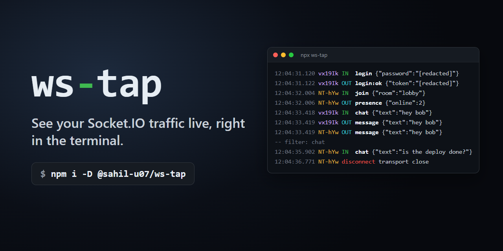
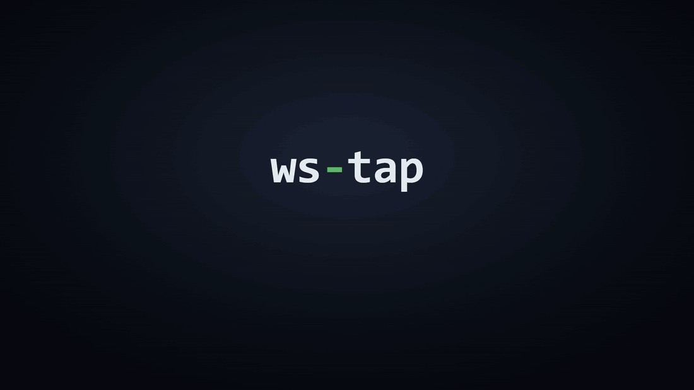
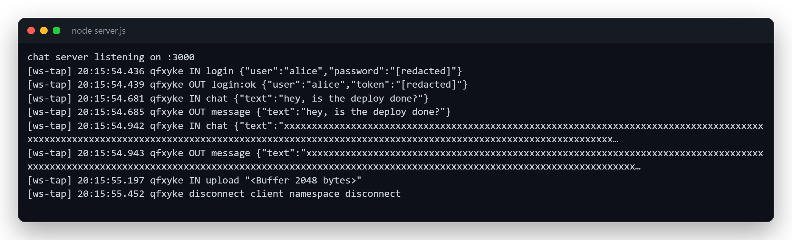
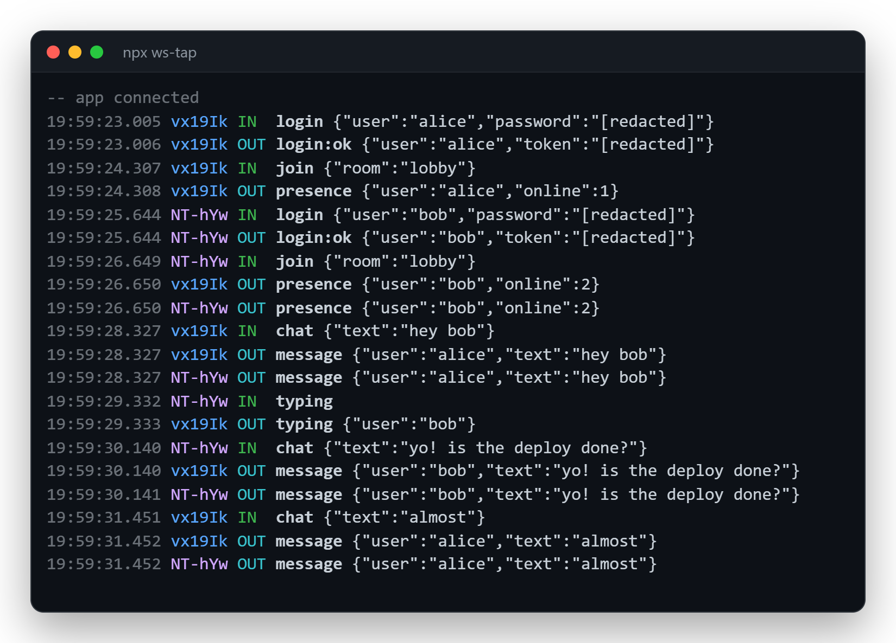
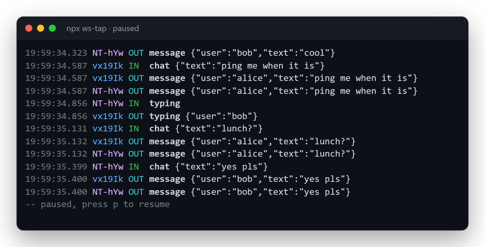
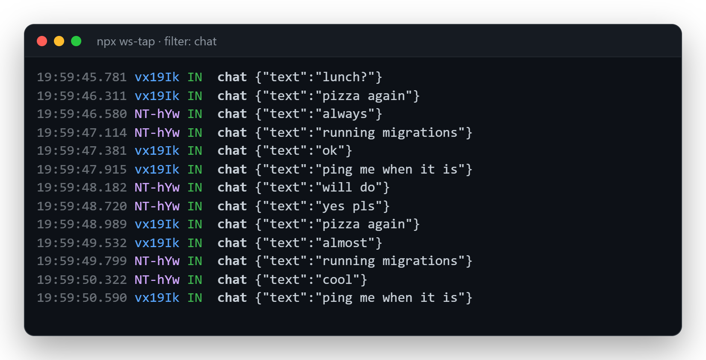
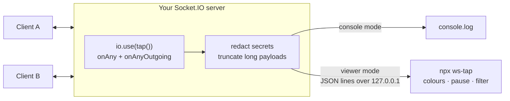
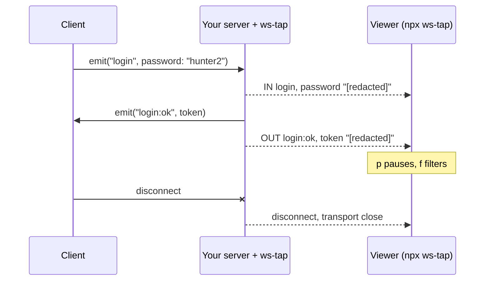
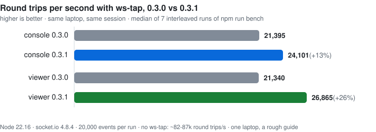

<p align="center">
  
</p>

<p align="center">
  <a href="https://github.com/Sahil-u07/ws-tap/actions/workflows/test.yml"></a>
  <a href="https://www.npmjs.com/package/@sahil-u07/ws-tap"></a>
  
  
  <a href="LICENSE"></a>
</p>

<p align="center">
  <b>One line in your server. Every Socket.IO event, live, in a second terminal.</b><br>
  Pause it, filter it, and stop printing passwords by accident.
</p>

<p align="center">
  
</p>

<p align="center">
  <a href="https://github.com/Sahil-u07/ws-tap/releases/download/v0.3.0/ws-tap-demo.mp4"><b>▶ Watch the 50-second demo with sound</b></a>
</p>

---

## Why

Debugging Socket.IO usually goes like this: an event doesn't arrive, so you add `console.log` to five handlers, restart, scroll through the output, find the problem, and delete the logs again. Next week, same thing.

ws-tap does that job once, properly.

<table>
<tr><th width="50%">Before</th><th width="50%">After</th></tr>
<tr>
<td>

```js
socket.on('chat', (msg) => {
  console.log('chat in', msg);
  io.emit('message', msg);
  console.log('message out', msg);
});
socket.on('login', (creds) => {
  console.log('login', creds); // oops, password
  // ...
});
```

</td>
<td>

```js
io.use(tap({ viewer: true }));
```

```bash
npx ws-tap
```

Every event in and out, every client, secrets redacted.

</td>
</tr>
</table>

## Quick start

**1. Install**

```bash
npm install --save-dev @sahil-u07/ws-tap
```

**2. Add one line to your server**

```js
const { Server } = require('socket.io');
const tap = require('@sahil-u07/ws-tap');

const io = new Server(3000);
io.use(tap({ viewer: true }));
```

**3. Run the viewer in a second terminal**

```bash
npx ws-tap
```

That's it. Use your app as usual and watch the traffic. Prefer everything in one terminal? Use `io.use(tap())` and skip step 3.

## Features

<table>
<tr>
<td width="50%"><b>Both directions</b><br>Incoming events and everything you send: <code>socket.emit</code>, <code>io.emit</code>, rooms and broadcasts.</td>
<td width="50%"><b>A colour per socket</b><br>Follow one client through a busy stream without squinting at ids.</td>
</tr>
<tr>
<td><b>Pause</b><br>Press <code>p</code> when it gets busy. Events are held, not dropped, and print when you resume.</td>
<td><b>Filter</b><br>Press <code>f</code> and type <code>chat</code> for one event type, or <code>@abc</code> for one socket.</td>
</tr>
<tr>
<td><b>Secrets redacted</b><br><code>password</code>, <code>token</code>, <code>secret</code> and <code>authorization</code> are hidden at any depth, before anything leaves your app.</td>
<td><b>Safe to leave in</b><br>Does nothing in production, can't crash your app, and never keeps your process alive.</td>
</tr>
<tr>
<td><b>Handles odd payloads</b><br>Circular objects, Buffers, ack callbacks and huge payloads all print as short, readable lines.</td>
<td><b>Tiny</b><br>Zero dependencies, about 200 lines of code, tested on Linux, Windows and macOS.</td>
</tr>
</table>

## Two ways to use it

### Console mode: `io.use(tap())`

Lines go straight to your server's console. Good for quick checks.

<p align="center"></p>

### Viewer mode: `io.use(tap({ viewer: true }))` + `npx ws-tap`

Traffic goes to its own terminal, colour-coded, and your server console stays clean. IN is green, OUT is cyan, disconnects are red, and every socket id gets its own colour.

<p align="center"></p>

You can start the viewer and your server in either order, restart the viewer whenever you like, and point several servers at the same viewer. If no viewer is running, events are simply dropped and your app doesn't notice.

### Pause and filter

| Key | What it does |
|-----|--------------|
| `p` or `space` | Pause / resume. Up to 1000 events are held while paused and printed when you resume. |
| `f` or `/` | Type a filter and press Enter. `Esc` keeps the old filter, and an empty one shows everything. |
| `q` or `Ctrl+C` | Quit. |

Filters: `chat` matches event names containing "chat" (any case). `@abc` matches socket ids starting with "abc". You can also start with one: `npx ws-tap --filter chat`.

<table>
<tr>
<td width="50%"></td>
<td width="50%"></td>
</tr>
<tr>
<td align="center">Paused: nothing scrolls away while you read.</td>
<td align="center">Filtered to <code>chat</code>: only the events you care about.</td>
</tr>
</table>

## How it works



ws-tap is a normal Socket.IO middleware. For every socket it registers `socket.onAny` (incoming), `socket.onAnyOutgoing` (outgoing, which also covers `io.emit` and room broadcasts) and a `disconnect` listener. Each event is cleaned up inside your process (secrets redacted, cycles and binary replaced, long payloads cut) and then either printed or sent to the viewer as one JSON line over a local TCP connection.



## Options

```js
io.use(tap({
  viewer: true,         // or a port number; default port is 4400
  maxLength: 500,       // cut payloads longer than this (default 200)
  log: (line) => logger.debug(line), // send lines somewhere else
  enabled: true,        // force on (or off) regardless of NODE_ENV
}));
```

| Option | Default | What it does |
|--------|---------|--------------|
| `viewer` | off | `true` or a port number: stream events to `npx ws-tap` instead of the console. |
| `maxLength` | `200` | Payloads longer than this are cut and end with `…`. |
| `log` | `console.log`, or none when `viewer` is set | Where each line goes. Gets one string per event. Pass it with `viewer` to get both. |
| `enabled` | `true` unless `NODE_ENV=production` | Force logging on or off. |

Viewer flags: `npx ws-tap --port 5000` (`-p`) and `npx ws-tap --filter chat` (`-f`).

## Safety

ws-tap is built to be left in your dev setup and forgotten about.

| Promise | How |
|---------|-----|
| Off in production | When `NODE_ENV=production` the middleware is a plain `next()` unless you pass `enabled: true`. |
| Can't break your app | Every hook is wrapped in `try/catch`. Even a `log` function that throws is ignored. |
| Secrets stay in your process | Keys named `password`, `token`, `secret` or `authorization` (any case, any depth) become `[redacted]` before anything is printed or sent. |
| Odd payloads are fine | Circular references print `[circular]`, Buffers and typed arrays print `<Buffer N bytes>`, ack callbacks print `<ack>`, and `toJSON` (like on Dates) is respected. |
| No memory build-up | Without a viewer, events are dropped. If the viewer falls more than 1 MB behind, events are dropped. While paused, the viewer holds at most 1000. |
| Local only | The viewer listens on `127.0.0.1`, never on your network. |
| Never keeps your process alive | The connection to the viewer is `unref()`'d. |

## Performance

It's a dev tool, but I still wanted to know what it costs, so there's a benchmark: one client fires 20,000 events, the server echoes each one back, and every round trip logs two events (IN and OUT).

<p align="center">
  <picture>
    <source media="(prefers-color-scheme: dark)" srcset="docs/benchmark-dark.svg">
    
  </picture>
</p>

In this session that works out to about **13-15 µs per logged event** for 0.3.1, down from about 18 µs for 0.3.0. A busy dev server doing 1,000 events a second spends roughly 1% of one CPU core on ws-tap. With viewer mode on and no viewer running it does no formatting at all, and in production it costs nothing because it's switched off.

0.3.1 got faster by building the timestamp once per millisecond instead of once per event, and by writing each line in a single pass that stops at `maxLength` (so a huge payload is barely read). Run it yourself with `npm run bench`. On laptops, compare runs from the same session: the benchmark measures "no ws-tap" first, so the ws-tap modes can end up running on a CPU that has already left turbo.

## How it compares

| | `console.log` in handlers | `DEBUG=socket.io:*` | Browser devtools | **ws-tap** |
|---|:---:|:---:|:---:|:---:|
| Setup | edit every handler | env variable | open devtools | **one line** |
| Sees every client | only what you log | yes | one tab | **yes** |
| Outgoing broadcasts | if you remember | yes | that tab only | **yes** |
| Readable app payloads | yes | buried in protocol noise | yes | **yes** |
| Redacts secrets | no | no | no | **yes** |
| Pause and filter | no | grep | filter only | **yes** |

## FAQ

<details>
<summary><b>Does it work with namespaces?</b></summary>

`io.use()` covers the main namespace. For others, add it there too: `io.of('/admin').use(tap({ viewer: true }))`. Adapters (like Redis) don't matter, because ws-tap watches what each socket sends and receives.
</details>

<details>
<summary><b><code>npx ws-tap</code> says the command isn't found</b></summary>

`npx ws-tap` uses the copy installed in your project. Install it first (`npm i -D @sahil-u07/ws-tap`), or run it without installing: `npx @sahil-u07/ws-tap`.
</details>

<details>
<summary><b>Port 4400 is already in use</b></summary>

Pick another one on both sides: `npx ws-tap --port 5000` and `tap({ viewer: 5000 })`.
</details>

<details>
<summary><b>Can I use ES modules or TypeScript?</b></summary>

Yes, `import tap from '@sahil-u07/ws-tap'` works in ES modules (and in TypeScript with `esModuleInterop`). Type definitions aren't bundled yet; that's on the roadmap.
</details>

<details>
<summary><b>Why is the package scoped (<code>@sahil-u07/</code>)?</b></summary>

npm rejected the plain `ws-tap` name for being too similar to an existing package. The command is still `ws-tap`.
</details>

<details>
<summary><b>Should I run it in production?</b></summary>

It's built for development and switches itself off when `NODE_ENV=production`. You can force it on with `enabled: true` for a quick look, but it logs every event, so don't leave it like that.
</details>

## Try the example

```bash
git clone https://github.com/Sahil-u07/ws-tap && cd ws-tap
npm install
npm run viewer                       # terminal 1
node example/server.js --viewer      # terminal 2
node example/client.js               # terminal 3
```

Leave out `--viewer` (and terminal 1) to see console mode.

## Requirements

- Node.js 22.13 or newer
- socket.io 4.5 or newer on the server (for `socket.onAnyOutgoing`)

## Roadmap

- [x] v1: console logger with redaction and truncation
- [x] v2: terminal viewer with colours per socket
- [x] v3: pause/resume and filters
- [ ] Show ack (callback) responses
- [ ] Room and namespace on each line
- [ ] `--save session.jsonl` to record a session, and replay it later
- [ ] Time between a request and its reply
- [ ] Bundled TypeScript types

Ideas and issues are very welcome.

## Contributing

```bash
npm install
npm test          # node:test, real server + client + viewer
npm run bench     # the numbers above
```

Bug reports and PRs are welcome. Please keep it small and dependency-free.

## License

[MIT](LICENSE) © Sahil Lenka
